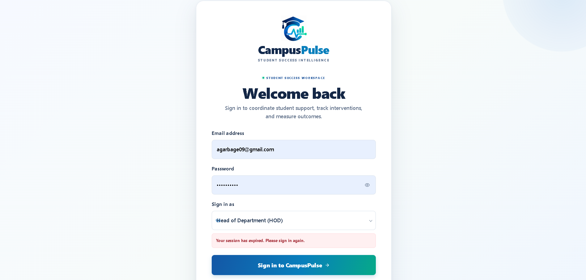
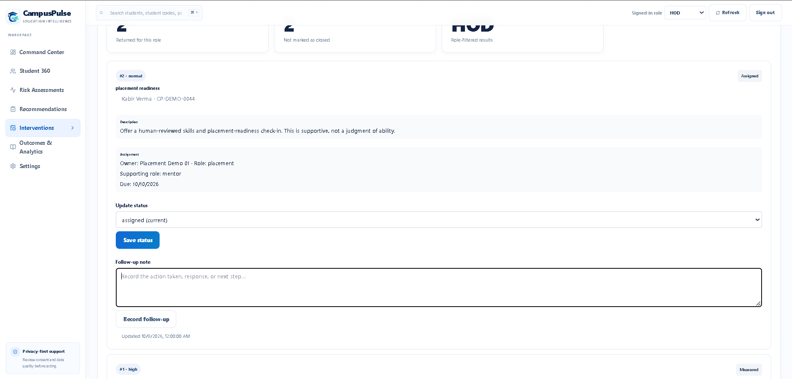
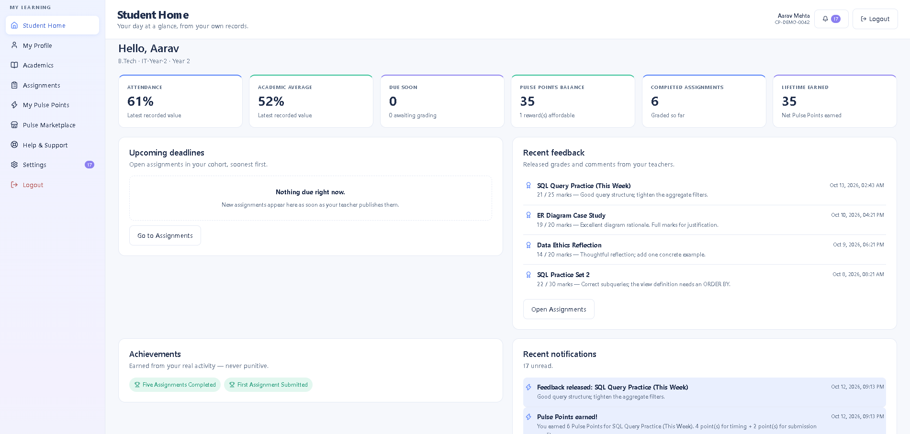
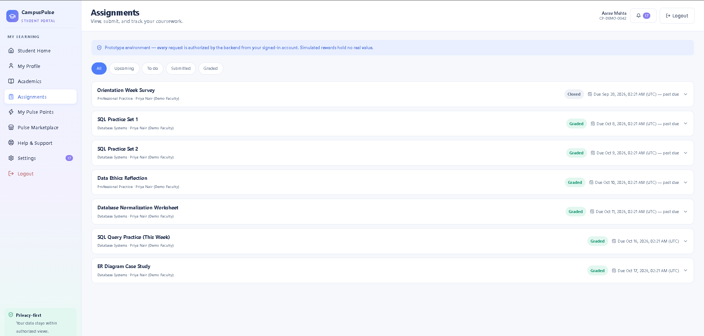
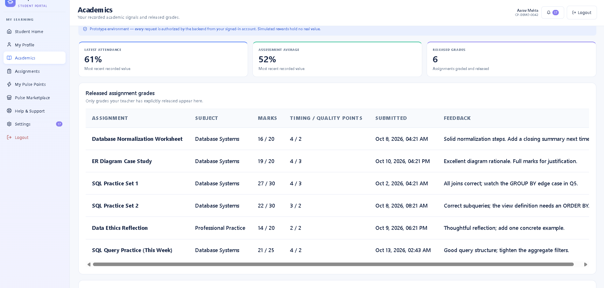
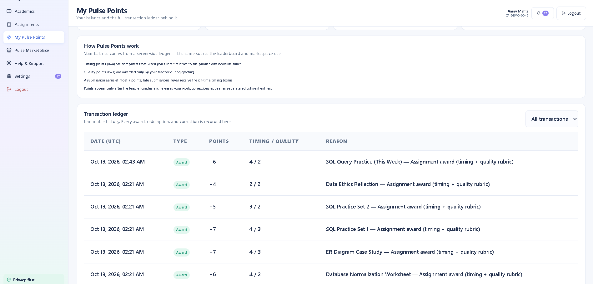

# CampusPulse

### A Student Success and Intervention Orchestration Engine

CampusPulse is a hackathon prototype for PS6. It connects fragmented student-success signals to explainable, consent-aware, human-reviewed support workflows, with accountable follow-up and recorded outcomes.

> **Core differentiator:** CampusPulse coordinates support actions and tracks what happened afterward—not just a risk score or dashboard.

## Problem

Institutions may hold attendance, academic, participation, fee, skills, and faculty-feedback data without a reliable way to coordinate timely support. CampusPulse is designed to connect permitted signals to a reviewed support action, a responsible stakeholder, a deadline, follow-up evidence, and an outcome record.

## Core Workflow

1. Review a synthetic student's permitted Student 360 view.
2. Inspect explainable review-priority indicators.
3. Review a context-aware support recommendation.
4. Approve, edit, override, or decline the recommendation.
5. Assign an intervention owner/team and deadline.
6. Record timestamped follow-up evidence.
7. Record outcome measurements when available.
8. Review cohort-level analytics.

## Features

### Staff Workspace
- Student 360 view with purpose-specific consent and permitted signals
- Explainable early-warning/review-priority indicators
- Context-aware support recommendations
- Human review and manual override
- Intervention assignments, owners, deadlines, statuses, and follow-up history
- Outcome recording and cohort-level analytics
- Role-aware access and privacy-focused workflows

### Student Portal
- Student dashboard, profile, and permitted academic information
- Assignment deadlines, submissions, released grades, and feedback
- Pulse Points with a transaction ledger
- Rewards marketplace, leaderboard, and redemption history
- Notifications and human-reviewed support requests

### Demo Data
- Synthetic student cohort and curated demonstration scenarios
- Simulated rewards clearly labelled as demo-only
- Reproducible synthetic-data generator

## 📸 Application Screenshots

Screenshots are stored in the root-level `screenshots/` directory. The paths below match the filenames in the current project.

### Login



### Staff Workspace

#### Student 360 — Profile, Consent & Permitted Signals

Review student information, purpose-specific consent, and permitted academic signals.


#### Intervention Management

Track assigned support actions, responsible staff, status updates, deadlines, and follow-up notes.



### Student Portal

#### Student Dashboard

View academic summaries, attendance, deadlines, released feedback, achievements, and notifications.



#### Assignments

View coursework, deadlines, submission status, and released grades.



#### Academics

Review recorded attendance, academic averages, released grades, and assignment feedback.



#### Pulse Points

Track earned points and review the transaction ledger, including timing and quality awards.



#### Pulse Marketplace

Explore rewards, leaderboard rankings, and redemption history. Rewards marked as simulated are for demonstration purposes only.


#### Help & Support

Submit support requests for human review and track their status.


> Screenshots show the local demonstration environment and synthetic demo data. CampusPulse is a prototype; simulated rewards have no real-world monetary value.

## Technology Stack

- **Frontend:** React, Vite, TypeScript, Recharts, Lucide
- **Backend:** Python, FastAPI, Pydantic, SQLAlchemy, Uvicorn
- **Database:** SQLite
- **Testing:** Pytest and HTTPX

## Repository Layout

```text
CampusPulse/
├── backend/
├── frontend/
├── datasets/
├── docs/
├── notebooks/
├── screenshots/
└── README.md
```

## Run Locally

### Requirements

- Python 3.11
- Node.js LTS and npm
- Git
- Conda is optional if you prefer an isolated Python environment

### 1. Start the backend

From the repository root, activate your environment and install backend dependencies:

```powershell
conda activate campuspulse-fresh
python -m pip install -r backend/requirements.txt
python -m uvicorn app.main:app --app-dir backend --reload
```

API documentation:

- http://127.0.0.1:8000/docs

### 2. Start the frontend

Open a second terminal:

```powershell
cd frontend
npm ci
npm run dev
```

Open the local URL printed by Vite in the terminal (commonly `http://localhost:5173`).

## Synthetic Cohort Generator

With the project environment active:

```powershell
cd backend
python -m app.seed.seed_large_dataset --count 2000
```

The count is the target number of generated `CP-SYN-*` students; curated `CP-DEMO-*` students are kept separately. The generator creates fictional students and synthetic signals. These records are not real institutional data or evidence of real-world outcomes.

## Demo Accounts and Security

If demo accounts are enabled in your local configuration, use only the dedicated local demo accounts documented for your current project setup. Do not publish private credentials.

**Prototype security limitations:** before any public or real-institution deployment, review and complete authentication/session enforcement, privileged-role assignment, rate limiting, HTTPS, account recovery, audit logging, and data-protection controls. Use synthetic data only until the security model has been fully reviewed.

## Responsible Design

- Use synthetic data in the prototype.
- Treat risk indicators as decision support, not diagnosis.
- Never automatically punish or discipline students based on a score.
- Do not treat missing data as negative evidence.
- Restrict financial and sensitive counselling information.
- Require human review for consequential support decisions.
- Distinguish illustrative examples from recorded outcomes.
- Avoid unsupported causal claims about intervention effectiveness.

## Documentation

See the `docs/` directory for project documentation, including the acceptance checklist, demo scenario, role-permission matrix, data model, privacy and consent rules, API contract, and architecture notes.

## Project Status

CampusPulse is a working hackathon prototype. Features and integrations should be evaluated against the current code and demo environment; this README does not imply that every planned production capability is complete.

## License

No license has been selected yet.
